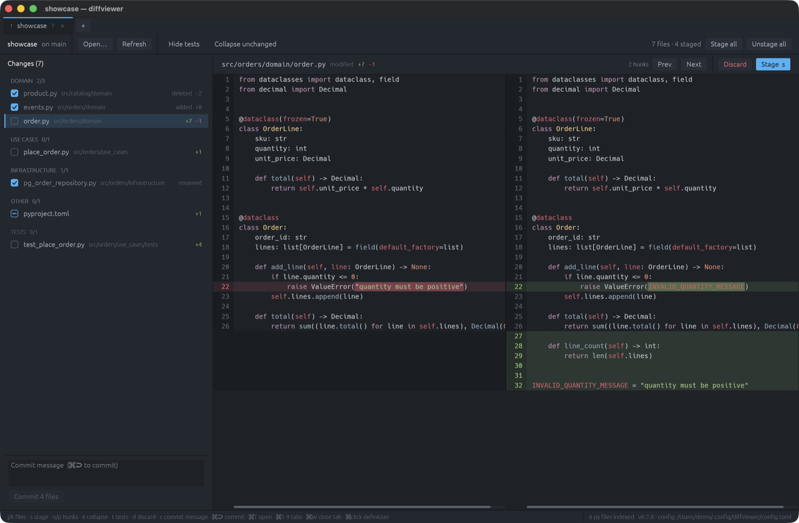

# diffviewer

A fast, keyboard-driven git diff reviewer for macOS and Linux. Built for the
loop where an agent writes code and you read every file before staging it.



## Why

- **Files ordered by what matters.** Changes are grouped by layer —
  Domain → Use cases → Application → Infrastructure → Other — with tests last.
  Layer names are configurable, so it works for any folder convention.
- **Stage as you review.** `s` stages the current file and jumps to the next
  unstaged one. The checkbox is your "reviewed" marker. Commit from the same
  window.
- **Real side-by-side diffs.** Syntax highlighting, word-level change
  emphasis, hunk navigation, collapsible unchanged regions, and independent
  horizontal scrolling per pane so long lines never push the other side away.
- **⌘-click to see a definition.** A built-in Python symbol index follows
  imports (including package re-exports) and opens the definition in a peek
  panel, without leaving the diff. Chain further with more ⌘-clicks, or open
  it in your editor.
- **Tabs, one window.** `dw <dir>` from any terminal opens the repo as a new
  tab in the running window. `⌘1`–`⌘9` switch tabs.
- **Always live.** The working tree is polled, so the list updates as files
  change on disk.

## Install

One line (macOS universal, Linux x86_64/aarch64):

```sh
curl -fsSL https://raw.githubusercontent.com/sleipner42/diffviewer/main/install.sh | sh
```

This puts `diffviewer` and the `dw` launcher in `~/.local/bin`
(override with `DIFFVIEWER_INSTALL_DIR`).

Homebrew:

```sh
brew install sleipner42/tap/diffviewer
```

From source (needs a Rust toolchain; on Linux also GTK 3, xkbcommon and
Wayland/X11 development headers):

```sh
git clone https://github.com/sleipner42/diffviewer
cd diffviewer
./scripts/install.sh
```

## Usage

```sh
dw              # review the repo containing the current directory
dw ~/code/app   # open another repo as a new tab
dw update       # update to the latest release
```

`dw` returns immediately; the app runs detached. If diffviewer is already
open, the directory is added as a tab in the existing window.

### Keys

| Key | Action |
| --- | --- |
| `j` / `k` | next / previous file |
| `s` or `space` | stage / unstage the file, then advance to the next unstaged file |
| `n` / `p` | next / previous hunk |
| `e` | collapse / expand unchanged lines |
| `t` | hide / show tests |
| `d` | discard the file's changes (asks first) |
| `c` | focus the commit message |
| `⌘↩` | commit staged files |
| `⌘click` | peek at a definition · `⌘[` back · `esc` close |
| `⌘T` | open a folder in a new tab |
| `⌘1`–`⌘9`, `⌃Tab` | switch tabs · `⌘W` closes the tab |
| `⌘⇧A` | stage everything |

On Linux, `Ctrl` replaces `⌘`.

## Updates

The app checks GitHub Releases on startup and shows an **Update** button in the
status bar when a newer version exists. `dw update` does the same from the
terminal, and Homebrew installs update with `brew upgrade diffviewer`.

## Configuration

`~/.config/diffviewer/config.toml` — every key is optional. See
[`config.example.toml`](config.example.toml) for the full set:

```toml
tiers = [
  { name = "Domain", markers = ["domain"] },
  { name = "Use cases", markers = ["use_cases", "usecases", "use-cases"] },
  { name = "Application", markers = ["application", "app", "api", "presentation"] },
  { name = "Infrastructure", markers = ["infrastructure", "infra", "adapters"] },
]
test_markers = ["tests", "test", "__tests__", "spec", "specs"]
hide_tests = false
editor_command = "zed {path}:{line}"
```

A file belongs to the innermost directory that matches a tier marker; anything
else lands in *Other*. Tests are detected by directory (`tests/`, `spec/`, …)
or by name (`test_*.py`, `*_test.py`, `*.spec.ts`, …).

## How it works

Everything goes through the `git` CLI, so hooks, credentials and your global
config behave exactly as in the terminal. Diffs are always HEAD → working tree,
regardless of what is staged, so you see the full change the author made.

Releases are built by GitHub Actions from tags (`v*`); the installer and the
in-app updater both fetch from GitHub Releases.

## Development

```sh
cargo run -- path/to/repo
cargo test
```

The code is split into `domain` (diffing, importance ordering, Python symbol
index), `application` (review service, repository port), `infra` (git CLI,
config, highlighting, background workers) and `ui` (egui).
